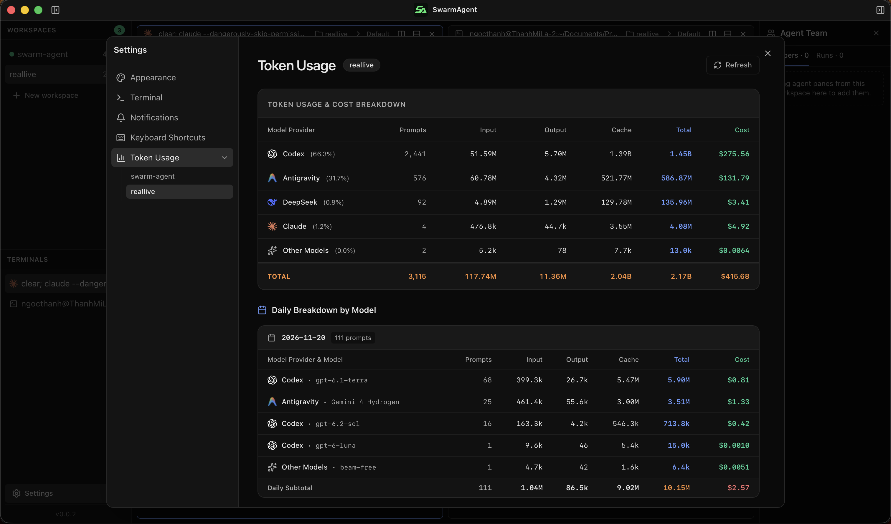

<div align="center">


# SwarmAgent

### Desktop workspace for multi-agent coding

[](CHANGELOG.md#011---2026-11-20)
[](LICENSE)

 

 
 
 
 
 
 


</div>

## Coordinate agents in one workspace

Split your workspace into terminal panes and see which agents are working,
finished, or waiting for input. Drag **Codex**, **Antigravity**, **OpenCode**, or
**Claude Code** panes into **Agent Team** to delegate tasks by name. Each pane
has its own identity, so you can assign different work to `codex-1` and
`codex-2` in the same checkout.


SwarmAgent sends each worker’s report back to the original leader as soon as
it can receive it. Open **Runs** to see individual results and delivery status.
Open **Settings → Run History** to see run counts and clear runs for one
workspace or all open workspaces.

## Track token usage

Open **Settings → Token Usage** to review the selected workspace’s input,
output, and cached tokens. Compare totals and estimated costs by provider,
and use the daily breakdown to see how usage changes over time.



## Get started

Download the [macOS Apple Silicon DMG](https://github.com/ThanhMiLa/swarm-agent/releases/latest)
from GitHub Releases. The build is ad-hoc signed and installed manually.
Install the agent CLIs you want to use so they’re available in the workspace
composer.

1. Open a Git checkout in the composer, choose your agents, and press
   `⌘/Ctrl + Enter` to open the workspace.
2. Drag each agent pane by its header into **Agent Team**. Check **Members**
   for the pane names and wait until they show **Ready**.
3. In the pane you want to lead, send a prompt like this one.

   > [TEAM] Ask codex-2 to verify the quick-start commands and antigravity-1
   > to review the workspace setup steps. Have both report their findings.

4. Open **Runs** to follow the handoffs and read the reports.

## Run from source

Install Node.js, Rust and the [Tauri prerequisites](https://tauri.app/start/prerequisites/).

```sh
git clone https://github.com/ThanhMiLa/swarm-agent.git
cd swarm-agent
npm install
npm run tauri dev
```

## Documentation

- Setup, shortcuts, and troubleshooting in the [user guide](docs/user-guide.md).
- Terminal and Agent Team internals in the [architecture guide](docs/architecture.md).

## License

SwarmAgent is licensed under the [GNU General Public License v3.0](LICENSE).

## Credits

SwarmAgent is based on [Swarmterm](https://github.com/duongducnguyen/swarmterm) by duongducnguyen and further developed by [ThanhMiLa](https://github.com/ThanhMiLa).
