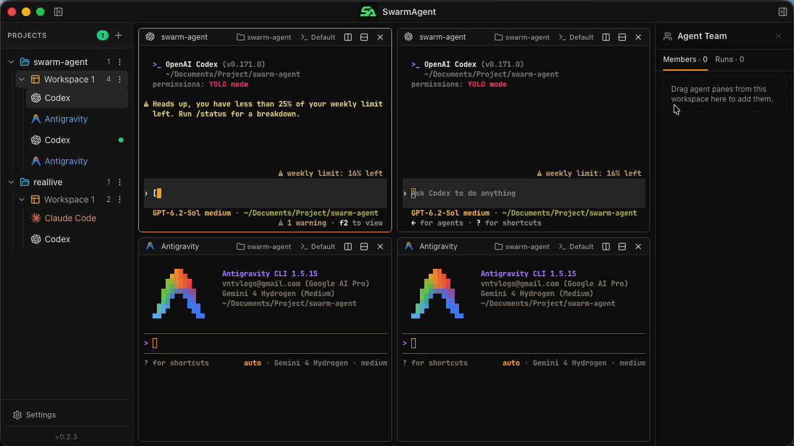
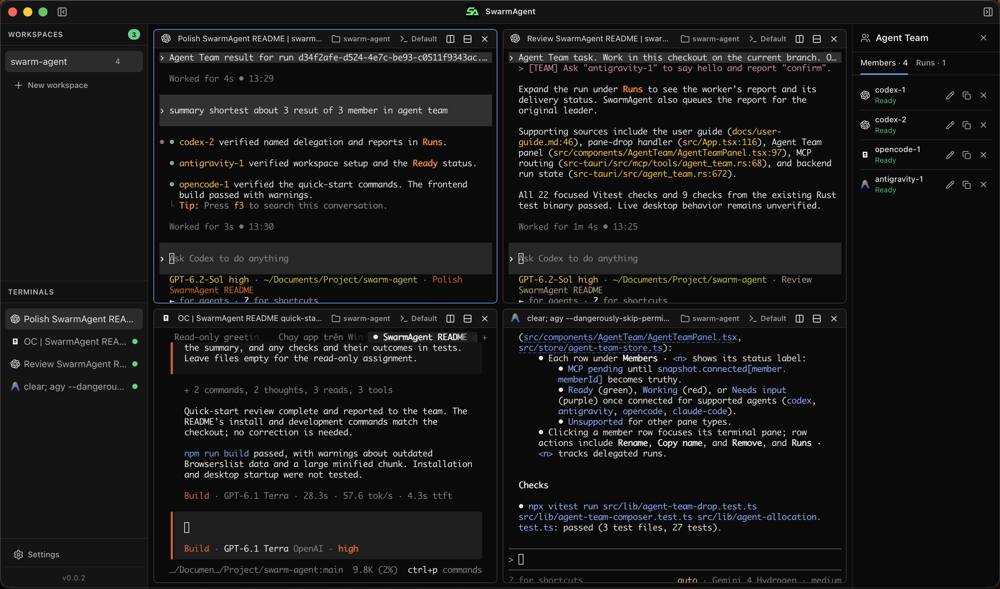

<div align="center">


# SwarmAgent

### Desktop workspace for multi-agent coding

[](CHANGELOG.md#027---2026-11-27)
[](LICENSE)

 

 
 
 
 
 
 



</div>

## Features

### Split terminal panes and Agent Team

Run agents side by side in one workspace, see their status, and delegate tasks
across Codex, Antigravity, OpenCode, and Claude Code with **Agent Team**.



### Token usage tracking

Track input, output, and cached tokens by provider, with daily usage and
estimated costs.


## Get started

Download the [macOS Apple Silicon DMG](https://github.com/ThanhMiLa/swarm-agent/releases/latest)
or [Windows x64 installer](https://github.com/ThanhMiLa/swarm-agent/releases/latest)
from GitHub Releases. Builds are currently unsigned (ad-hoc signed on macOS;
on Windows, click **More info → Run anyway** if SmartScreen warns, or turn off
**Smart App Control** if Windows 11 blocks unsigned installers).
Install the agent CLIs you want to use so they’re available in the workspace
composer.

1. Open a Git checkout in the composer, choose your agents, and press
   `⌘/Ctrl + Enter` to open the workspace.
2. Drag each agent pane by its header into **Agent Team**. Check **Members**
   for the pane names and wait until they show **Ready**.
3. In the pane you want to lead, send a prompt like this one.

   > [TEAM] Ask codex-2 to verify the quick-start commands and antigravity-1
   > to review the workspace setup steps. Have both report their findings.

4. Open **Runs** to follow the handoffs and read the reports.

## Run from source

Install Node.js, Rust and the [Tauri prerequisites](https://tauri.app/start/prerequisites/).

```sh
git clone https://github.com/ThanhMiLa/swarm-agent.git
cd swarm-agent
npm install
npm run tauri dev
```

## Documentation

- Setup, shortcuts, and troubleshooting in the [user guide](docs/user-guide.md).
- Terminal and Agent Team internals in the [architecture guide](docs/architecture.md).

## License

SwarmAgent is licensed under the [GNU General Public License v3.0](LICENSE).

## Credits

SwarmAgent is based on [Swarmterm](https://github.com/duongducnguyen/swarmterm) by duongducnguyen and further developed by [ThanhMiLa](https://github.com/ThanhMiLa).
